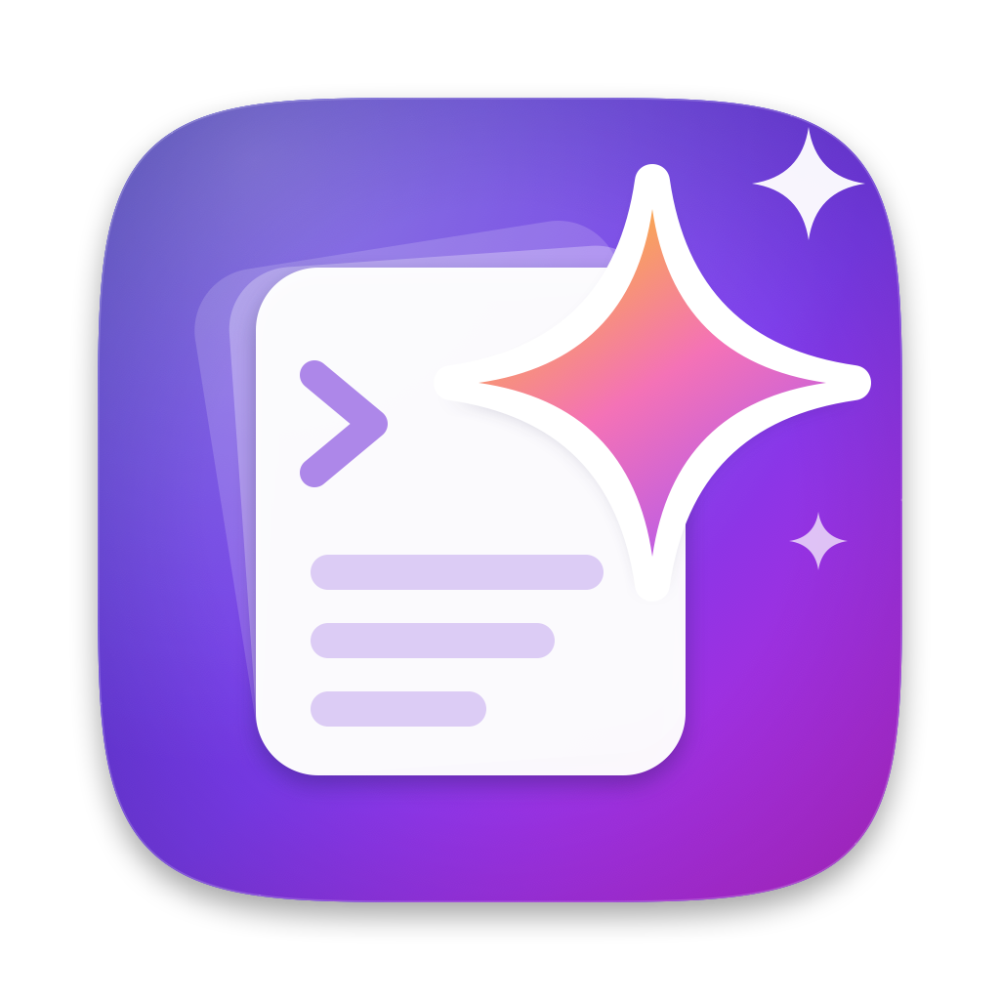
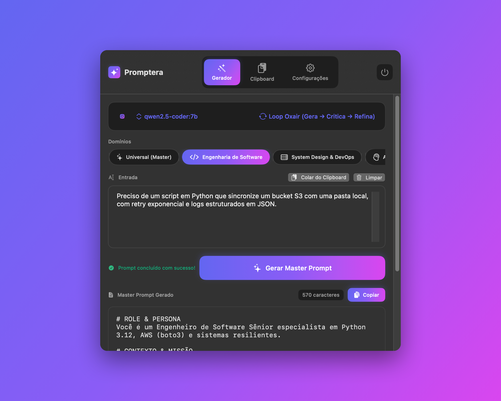
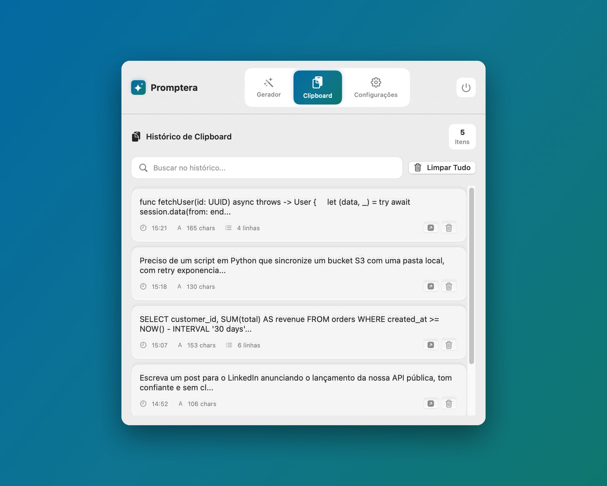
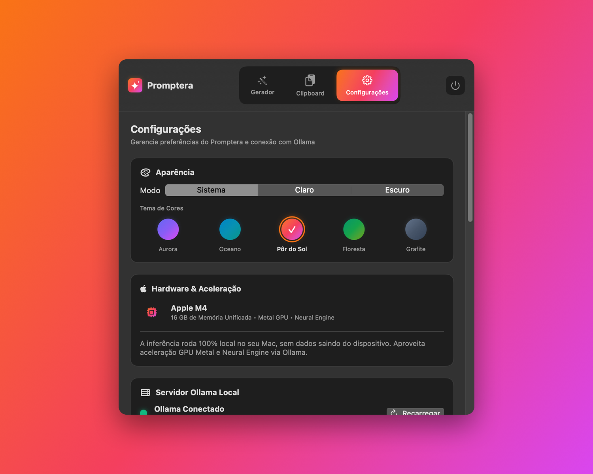
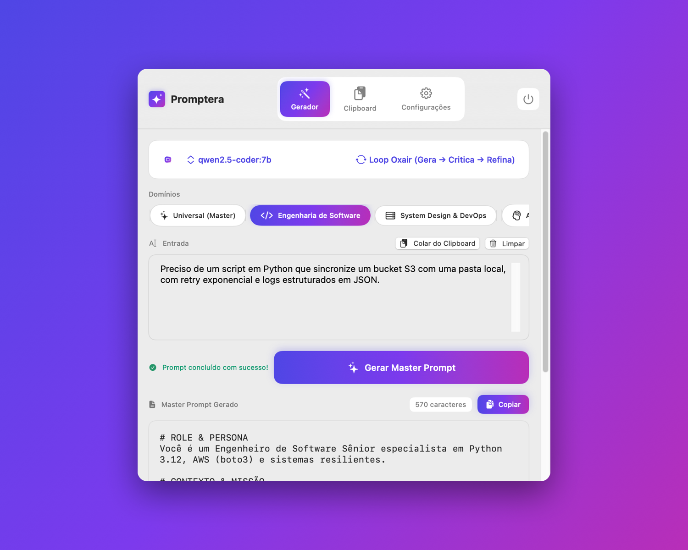

<p align="center"></p>

# 🪄 Promptera

**Promptera** is a native macOS app that lives in your **Menu Bar**, integrating a **Clipboard History Manager** with a **Prompt Engineering Harness** based on the Oxair methodology (*"How to Create Your Own AI Prompt Generator That Works Forever"*).

Promptera runs **100% locally and privately** with **Metal** hardware acceleration on your **Apple Silicon (M4)** processor using local models via **Ollama**, with a primary focus on **Gemma** — the small, efficient model from Google — to generate Master Prompts from the user's need.

[](https://github.com/lucasrafaldini/promptera/actions)
[](https://github.com/lucasrafaldini/promptera/actions)
[](https://swift.org)
[](https://apple.com/macos)
[](LICENSE)

**🌐 Idiomas / Languages / Idiomas:** [English](README.md) • [Português](README.pt.md) • [Español](README.es.md)

---

## 📸 Screenshots

Download the latest `.dmg` in [Releases](https://github.com/lucasrafaldini/Promptera/releases/latest).

| | |
|---|---|
|  |  |
| *Generator — Aurora (dark)* | *Clipboard history — Ocean (light)* |
|  |  |
| *Settings with 5 color themes — Sunset (dark)* | *Generator — Aurora (light)* |

---

## 🌟 Key Features

### 1. Direct Menu Bar Access
- Elegant icon in macOS menu bar (`MenuBarExtra` native)
- No Dock pollution (`LSUIElement = true`)
- Fast, responsive SwiftUI interface with Dark/Light Mode support
- Animated tab transitions

### 2. Integrated Clipboard History
- Continuous background monitoring of `NSPasteboard`
- Searchable history of recent text and code snippets
- Real-time fuzzy search: ranks the best matches first, ignores case/diacritics and highlights the matched characters
- 1-click to load any item as context for prompt generation
- 1-click to copy generated Master Prompt back to clipboard
- Context menu actions (right-click)
- Encrypted local persistence between sessions

### 3. Prompt Creation Harness (Oxair Methodology)
- **Oxair Loop (Generate → Critique → Refine):** AI drafts, audits own flaws/implicit assumptions, synthesizes a battle-tested Master Prompt
- **Modular Mode:** Adds dynamic variables (`{{variable}}`) to transform prompt into reusable template
- **Direct Mode:** Structured Master Prompt in single pass
- **Domain Presets:** Ready-to-use configurations for:
  - 🛠️ **Software Engineering** — Architecture, refactoring, tests, documentation
  - 🏗️ **System Design & DevOps** — Distributed systems, databases, microservices
  - 🧠 **Deep Analysis & Reasoning** — Complex problems, synthesis, decision-making
  - ✍️ **Copywriting & Content** — Persuasive copy, articles, documentation
  - ✨ **Universal (Master)** — Any general objective

### 4. Foco no Gemma + Apple Silicon M4
- **Setup fácil via o próprio Promptera:** assistente de primeira execução guia a instalação do Ollama e o download do modelo Gemma (`gemma3:1b`, leve e eficaz) — você já começa a gerar prompts em poucos cliques.
- Detecta e conecta ao servidor Ollama local (`http://127.0.0.1:11434`)
- Auto-seleciona os melhores modelos para M4 (Gemma priorizado, depois `qwen2.5-coder:7b`, `llama3.1`, `phi4-mini`, `deepseek-coder-v2`)
- Real-time token streaming
- 100% local — nenhum dado sai do seu Mac

### 5. Gemma Guardrail Harness (anti-delírio)
Como o Gemma é um modelo pequeno, o Promptera inclui um **harness de guardrails dedicado** para que ele nunca divirja na geração de prompts:
- **Saída estruturada forçada em JSON** via `format: "json"` do Ollama — nenhum texto solto fora do esquema.
- **Few-shot em Inglês** (língua do vendor) com exemplo de bom prompt.
- **Temperatura baixa (0.3)** para saídas determinísticas.
- **Validação rígida** dos campos obrigatórios (papel, objetivo, instruções, guardrails, schema de saída, placeholders).
- **Detecção de alucinação** (tags de pensamento, mensagens de recusa, JSON malformado).
- **Auto-reparo:** se o Gemma sair do esquema, o harness reenvia com a descrição do erro, até 3 tentativas.
- O Master Prompt final é renderizado em **Inglês (língua do vendor dos LLMs alvo)**, com opção de versão em Português.

### 6. Persistent Settings
- Model, preset, and mode saved automatically
- Configurable Ollama URL
- Full Export/Import (JSON)
  - Generated prompts and prompt library
  - Clipboard history
  - Settings

### 7. Prompt Library
- Every successful generation is saved automatically
- Dedicated **Library** tab with fuzzy search, edit, delete and “load into generator”
- Each entry keeps its original input, Master Prompt, preset, mode and model
- Encrypted at rest and included in Export/Import

### 8. Accessibility, Localization & Themes
- VoiceOver labels, hints, traits and custom actions across the main views
- Interface available in **English**, **Portuguese** and **Spanish**, switchable in Settings without restarting
- Five color themes, light/dark/system appearance and a custom accent color

### 9. Automatic Updates
- Built-in [Sparkle 2](https://sparkle-project.org) updater with Ed25519-signed appcasts
- Optional automatic checks, plus “Check for Updates” in Settings

### 10. Command Line Interface (CLI)
```bash
# Generate from provided text:
swift run promptera "Create a JWT auth microservice in Go"

# Or use current clipboard content:
swift run promptera --clipboard
```

---

## 🚀 How to Run

### Prerequisites
- macOS 14.0+ (Sonoma)
- [Ollama](https://ollama.ai) (o assistente do Promptera ajuda a instalar e iniciar)
- Modelo recomendado: `ollama pull gemma3:1b` (leve e eficaz) — ou `gemma3:4b` para mais qualidade

### 1. Inicie o Promptera e conclua o setup
O Promptera traz um **assistente de configuração na primeira execução** que:
1. Verifica se o Ollama está instalado (se não estiver, aponta para o download).
2. Verifica se o Ollama está rodando (`ollama serve` / app Ollama).
3. Faz o pull do modelo Gemma (`gemma3:1b`) direto pela interface.
4. Ativa o **Gemma Guardrail Harness** e você já começa a gerar prompts.

```bash
# Option A: Build and run directly
swift run PrompteraApp

# Option B: Build native .app
./scripts/build_app.sh
open build/Promptera.app
```

### 2. (Opcional) Instalar o Ollama manualmente
```bash
# Baixe em https://ollama.ai/download, depois inicie o servidor:
ollama serve
# Baixe o Gemma (leve e eficaz):
ollama pull gemma3:1b
```

### 3. (Opcional) Instalar no /Applications
```bash
cp -R build/Promptera.app /Applications/
```

Releases are built, signed and notarized by the workflow described in
[`docs/RELEASING.md`](docs/RELEASING.md), including Sparkle appcast generation.

---

## 🧪 Tests

```bash
# All tests (unit + E2E)
swift test

# Only fast unit tests
swift test --filter "PrompteraKitTests"

# With coverage (requires llvm-cov)
swift test --enable-code-coverage
xcrun llvm-cov export -format="lcov" .build/debug/PrompteraKitTests.xctest/Contents/MacOS/PrompteraKitTests -instr-profile .build/debug/codecov/default.profdata > coverage.lcov
```

The suite currently has **94 tests** covering clipboard management, fuzzy search,
localization, the prompt library, encryption and the Oxair harness.

---

## 🛠️ Code Structure

```
promptera/
├── Package.swift                     # Swift Package config (Sparkle + resources)
├── Sources/
│   ├── PrompteraKit/                 # Core Library (reusable)
│   │   ├── Models.swift              # Data models, presets and library items
│   │   ├── ClipboardManager.swift    # NSPasteboard monitoring and ranking
│   │   ├── FuzzyMatcher.swift        # Fuzzy search scoring
│   │   ├── Localization.swift        # AppLanguage, LanguageStore and L10n
│   │   ├── DesignSystem.swift        # Themes, appearance and accent colors
│   │   ├── EncryptionService.swift   # Encrypted local persistence
│   │   ├── OllamaClient.swift        # HTTP client with streaming
│   │   ├── PromptHarness.swift       # Meta-prompting engine (Oxair)
│   │   ├── PrompteraState.swift      # Reactive @MainActor state
│   │   └── Resources/                # en.lproj, pt.lproj, es.lproj
│   ├── PrompteraApp/                 # macOS App (SwiftUI MenuBar)
│   │   ├── PrompteraApp.swift        # MenuBarExtra entry point
│   │   ├── UpdateController.swift    # Sparkle wrapper
│   │   └── Views/
│   │       ├── MainMenuView.swift    # Main window, settings and tabs
│   │       ├── PromptGeneratorView.swift # Editor, presets, streaming
│   │       ├── PromptLibraryView.swift   # Saved prompts, search and editor
│   │       └── ClipboardHistoryView.swift # Copy/paste history
│   └── PrompteraCLI/                 # Terminal CLI interface
│       └── main.swift                # Command line executable
├── Tests/
│   └── PrompteraKitTests/            # 94 tests (unit + E2E)
├── scripts/
│   ├── build_app.sh                  # Build script for Promptera.app
│   ├── sign_app.sh                   # Developer ID signing
│   └── notarize.sh                   # Notarization and stapling
├── docs/RELEASING.md                 # Release, signing and Sparkle guide
├── .github/
│   ├── workflows/                    # CI/CD GitHub Actions
│   └── ISSUE_TEMPLATE/               # Issue templates
└── build/
    └── Promptera.app                 # Compiled app
```

---

## ⌨️ Keyboard Shortcuts

| Shortcut | Action |
|----------|--------|
| `⌘⏎` | Generate Master Prompt |
| `⎋` | Cancel generation |
| `⏎` / `⎋` | Save / cancel in the prompt library editor |

---

## 🤝 Contributing

We love contributions! See our [Contributing Guide](CONTRIBUTING.md) to get started.

### Good First Issues
- [Global keyboard shortcut](https://github.com/lucasrafaldini/Promptera/issues/3)
- [Multiple LLM providers](https://github.com/lucasrafaldini/Promptera/issues/6)
- [New domain presets](https://github.com/lucasrafaldini/Promptera/issues?q=label%3Aenhancement)

### Hacktoberfest
This project participates in **Hacktoberfest**! Issues tagged with `hacktoberfest` are ideal for contributions during the event.

---

## 📄 License

MIT License - see [LICENSE](LICENSE) for details.

---

## 🙏 Acknowledgments

- **Oxair** for the prompt engineering methodology
- **Ollama** for amazing local inference
- **Apple** for Silicon and native frameworks
- **Swift Community** for open source tools

---

## 📞 Support

- 🐛 [Report Bug](https://github.com/lucasrafaldini/promptera/issues/new?template=bug_report.md)
- 💡 [Request Feature](https://github.com/lucasrafaldini/promptera/issues/new?template=feature_request.md)
- 💬 [Discussions](https://github.com/lucasrafaldini/promptera/discussions)

---

**Made with ❤️ for the Apple Silicon developer community**